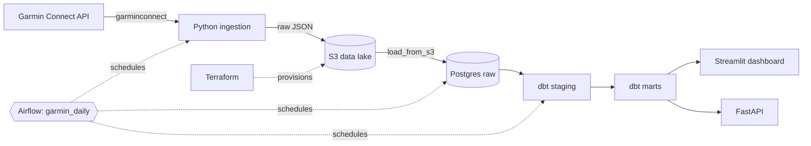
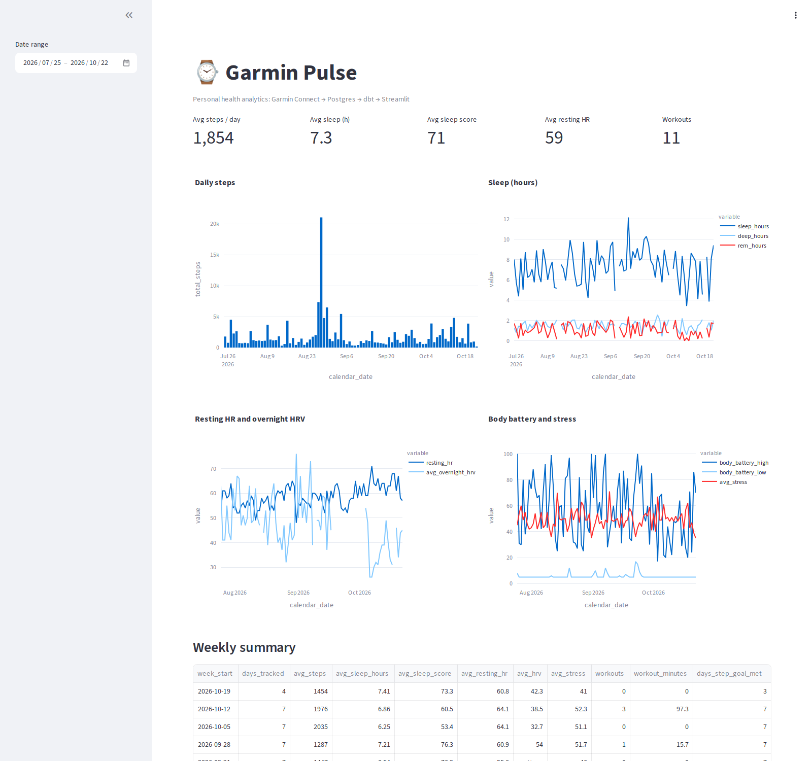

# Garmin Pulse


An end-to-end data engineering project built on my own Garmin Connect data: ingestion, warehouse modelling, orchestration, testing and a dashboard, all running locally with Docker Compose.

## Architecture



More detail in [docs/architecture.md](docs/architecture.md).

## Dashboard



## Stack

| Concern | Tool |
|---|---|
| Ingestion | Python, `garminconnect`, psycopg2 |
| Warehouse | PostgreSQL 16 (`raw`, `staging`, `marts`) |
| Data lake | S3 via boto3 (Floci emulator locally, AWS-compatible) |
| Infrastructure as code | Terraform (versioned, private S3 bucket) |
| Transformation | dbt (postgres adapter): 7 models, 26 tests incl. custom SQL tests and source freshness |
| Orchestration | Apache Airflow 2.10 (LocalExecutor) |
| Dashboard | Streamlit, Plotly |
| Infra | Docker Compose |
| CI | GitHub Actions: ruff, compile check, compose validation, `dbt parse`, Terraform apply and S3 integration tests against the emulator |

## Data model

- S3 `garmin-pulse-raw/raw/<endpoint>/<date>.json`: raw landing zone
- `raw.garmin_daily_summary`, `garmin_sleep`, `garmin_heart_rate`, `garmin_activities`: raw JSON payloads
- `staging.stg_garmin__*`: typed views
- `marts.fct_daily_health`: one row per day (steps, sleep, HRV, resting HR, stress, workouts)
- `marts.fct_workouts`: one row per activity
- `marts.fct_weekly_summary`: weekly rollup used by the dashboard

## Cloud-ready (emulated locally)

Raw Garmin JSON lands in an S3 bucket (`raw/<endpoint>/<date>.json`) before it reaches the warehouse, and the bucket is provisioned with Terraform. Locally this runs against Floci, an S3-compatible emulator in Docker Compose, so no real AWS account is used.

The code is endpoint-agnostic by design: leave `AWS_ENDPOINT_URL` empty and run Terraform with `-var endpoint_url=""` to target real AWS. I have not deployed it to AWS. CI runs `terraform apply` and integration tests against the emulator on every push.

## Run it

Prerequisites: Docker Desktop, Python 3.12+, a Garmin Connect account.

```bash
git clone https://github.com/buffandbearded/garmin-pulse.git
cd garmin-pulse
cp .env.example .env            # set POSTGRES_PASSWORD and Garmin credentials
docker compose up -d postgres aws
./infra/tf.sh init && ./infra/tf.sh apply -auto-approve   # creates the S3 bucket

python -m venv .venv && source .venv/Scripts/activate   # Linux/macOS: .venv/bin/activate
pip install -r ingestion/requirements.txt
python ingestion/garmin_auth.py                         # first login, caches tokens
python ingestion/ingest.py --days 90                    # Garmin -> S3
python ingestion/load_from_s3.py                        # S3 -> Postgres raw

docker compose run --rm dbt build                       # staging + marts + tests
docker compose run --rm airflow-init
docker compose up -d                                    # Airflow, dashboard, API
```

| Service | URL |
|---|---|
| Streamlit dashboard | http://localhost:8501 |
| Airflow UI (`admin` / `admin`, local only) | http://localhost:8080 |
| FastAPI docs | http://localhost:8000/docs |
| S3 emulator | http://localhost:4566 |
| Postgres | `localhost:5432` |

## API

A read-only FastAPI service over the marts: `GET /health`, `/daily`, `/weekly`, `/workouts`.
Interactive docs at http://localhost:8000/docs.

## Project layout

```
ingestion/   Garmin auth, S3 lake writer, S3-to-Postgres loader
dbt/         staging and marts models, tests
airflow/     Dockerfile and the garmin_daily DAG
dashboard/   Streamlit app
api/         FastAPI service over the marts
infra/       Terraform (S3 bucket) and the tf.sh wrapper
tests/       S3 integration tests
docker/      Postgres init scripts
.github/     CI workflow
```

## Notes

- All ports bind to `127.0.0.1`. Secrets live in `.env` (git-ignored).
- Loads are idempotent, so any date range can be re-run safely.
- The cloud layer is emulated locally (Floci). Nothing is deployed to a real AWS account.
- Possible next steps: dbt docs hosted on GitHub Pages, data freshness checks.
