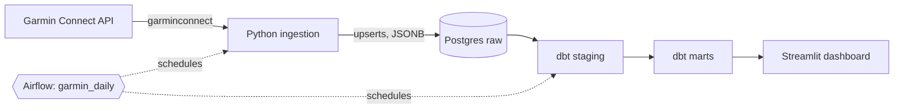

# Garmin Pulse


An end-to-end data engineering project built on my own Garmin Connect data: ingestion, warehouse modelling, orchestration, testing and a dashboard, all running locally with Docker Compose.

## Architecture



More detail in [docs/architecture.md](docs/architecture.md).

## Stack

| Concern | Tool |
|---|---|
| Ingestion | Python, `garminconnect`, psycopg2 |
| Warehouse | PostgreSQL 16 (`raw`, `staging`, `marts`) |
| Transformation | dbt (postgres adapter): 7 models, 14 tests |
| Orchestration | Apache Airflow 2.10 (LocalExecutor) |
| Dashboard | Streamlit, Plotly |
| Infra | Docker Compose |
| CI | GitHub Actions: ruff, compile check, compose validation, `dbt parse` |

## Data model

- `raw.garmin_daily_summary`, `garmin_sleep`, `garmin_heart_rate`, `garmin_activities`: raw JSON payloads
- `staging.stg_garmin__*`: typed views
- `marts.fct_daily_health`: one row per day (steps, sleep, HRV, resting HR, stress, workouts)
- `marts.fct_workouts`: one row per activity
- `marts.fct_weekly_summary`: weekly rollup used by the dashboard

## Run it

Prerequisites: Docker Desktop, Python 3.12+, a Garmin Connect account.

```bash
git clone https://github.com/buffandbearded/garmin-pulse.git
cd garmin-pulse
cp .env.example .env            # set POSTGRES_PASSWORD and Garmin credentials
docker compose up -d postgres

python -m venv .venv && source .venv/Scripts/activate   # Linux/macOS: .venv/bin/activate
pip install -r ingestion/requirements.txt
python ingestion/garmin_auth.py                         # first login, caches tokens
python ingestion/ingest.py --days 90                    # backfill

docker compose run --rm dbt build                       # staging + marts + tests
docker compose run --rm airflow-init
docker compose up -d                                    # Airflow, dashboard
```

| Service | URL |
|---|---|
| Streamlit dashboard | http://localhost:8501 |
| Airflow UI (`admin` / `admin`, local only) | http://localhost:8080 |
| Postgres | `localhost:5432` |

## Project layout

```
ingestion/   Garmin auth (token cache), raw loaders
dbt/         staging and marts models, tests
airflow/     Dockerfile and the garmin_daily DAG
dashboard/   Streamlit app
docker/      Postgres init scripts
.github/     CI workflow
```

## Notes

- All ports bind to `127.0.0.1`. Secrets live in `.env` (git-ignored).
- Loads are idempotent, so any date range can be re-run safely.
- Possible next steps: FastAPI layer over the marts, dbt docs hosted on GitHub Pages, data freshness checks.
