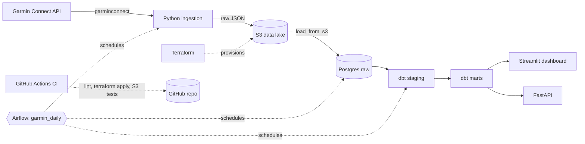

# Architecture

## Layers

| Layer | Schema | Built by | Contents |
|---|---|---|---|
| Raw | `raw` | Python ingestion | Untouched Garmin JSON in `jsonb`, one table per endpoint |
| Staging | `staging` | dbt (views) | Typed, renamed columns, one model per raw table |
| Marts | `marts` | dbt (tables) | `fct_daily_health`, `fct_workouts`, `fct_weekly_summary` |

## Design decisions

- **Raw JSON first (ELT):** the API payload is stored as received, so models can be rebuilt or extended without re-calling Garmin.
- **Idempotent loads:** `INSERT ... ON CONFLICT DO UPDATE` keyed by date or activity ID. Re-running any range is safe.
- **Rolling 3-day re-ingest:** the daily DAG overwrites recent days to catch late-syncing data.
- **dbt isolated from Airflow:** dbt lives in its own virtualenv inside the Airflow image to avoid dependency conflicts.
- **Local-only ports:** all services bind to `127.0.0.1`; secrets live in a git-ignored `.env`.
